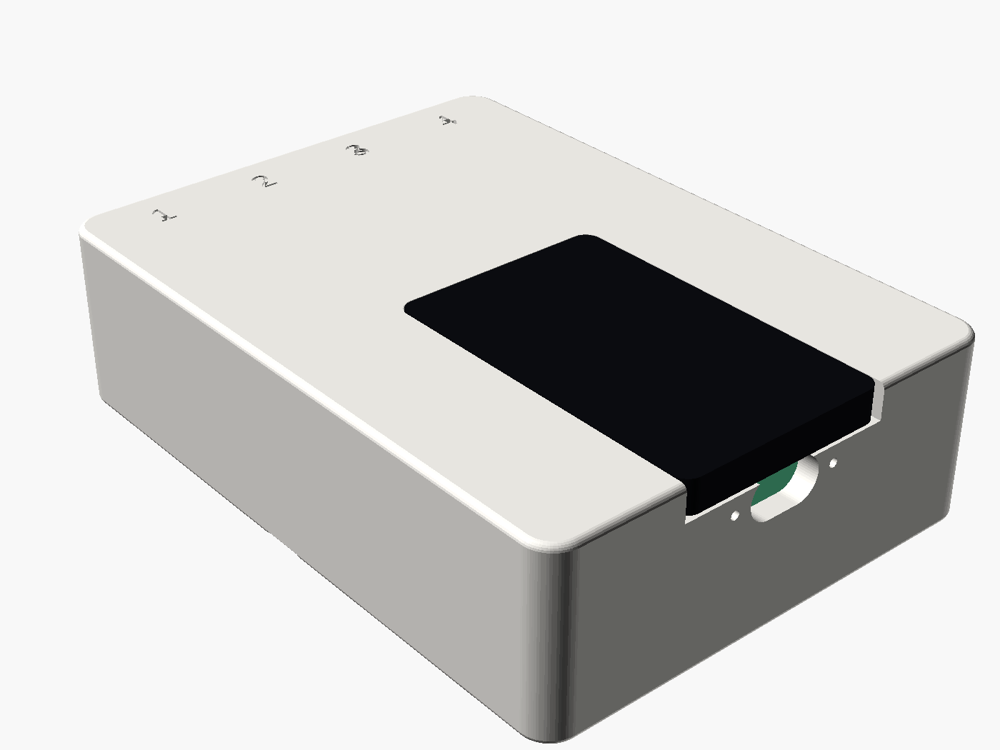
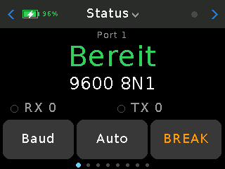
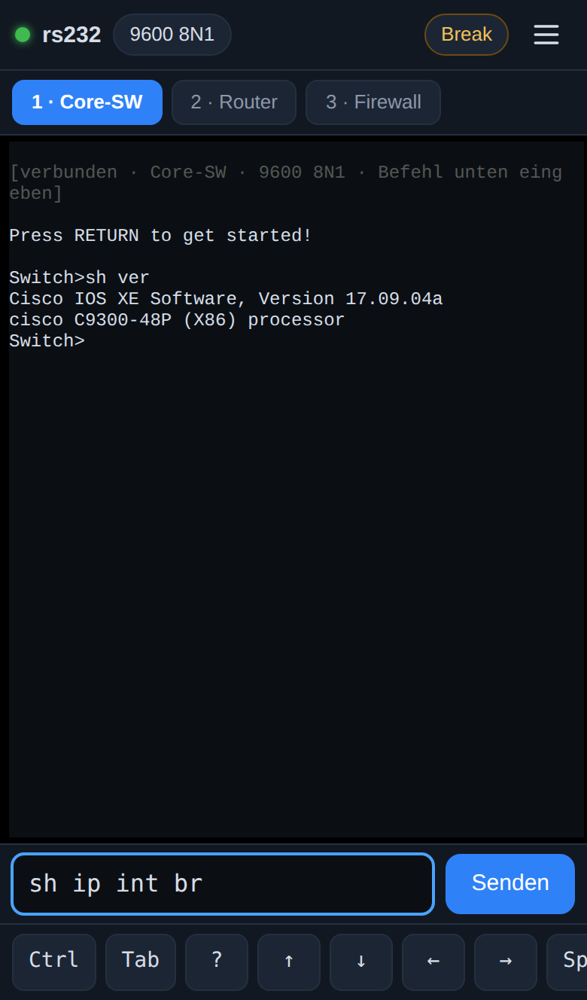
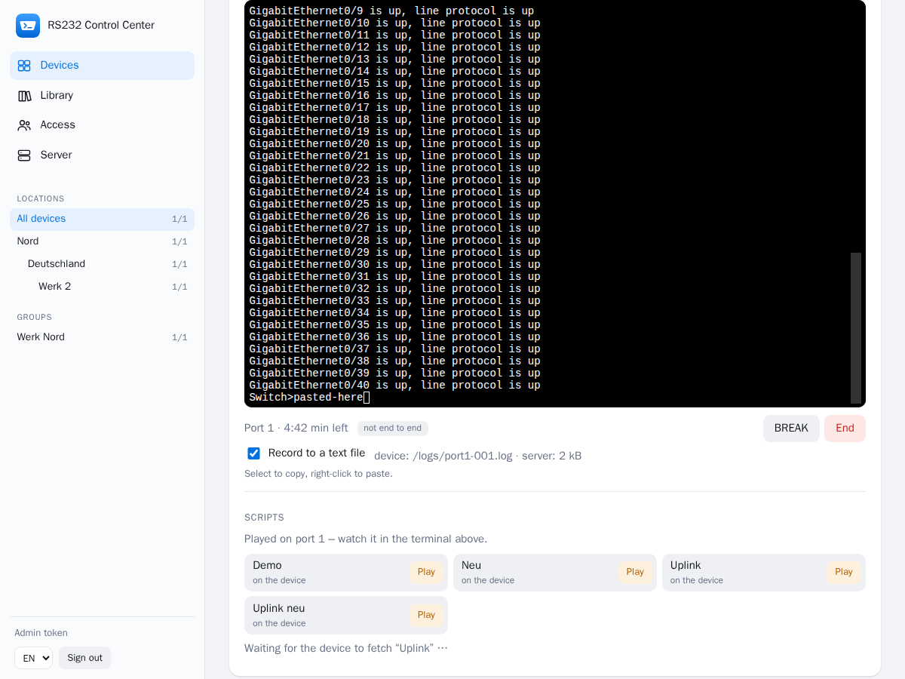
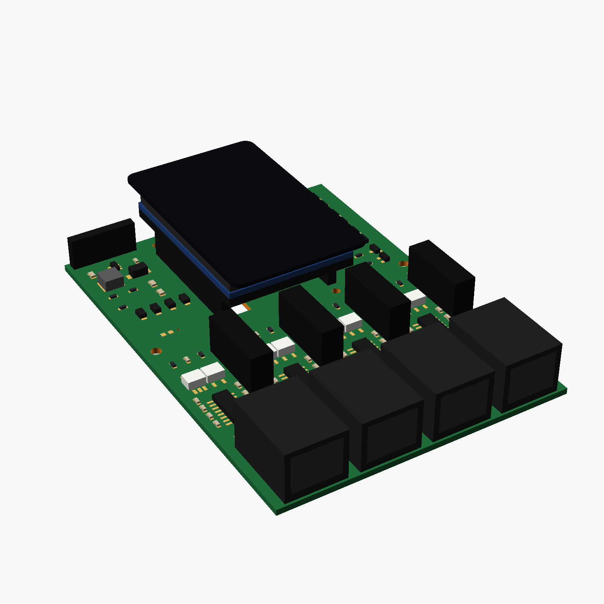
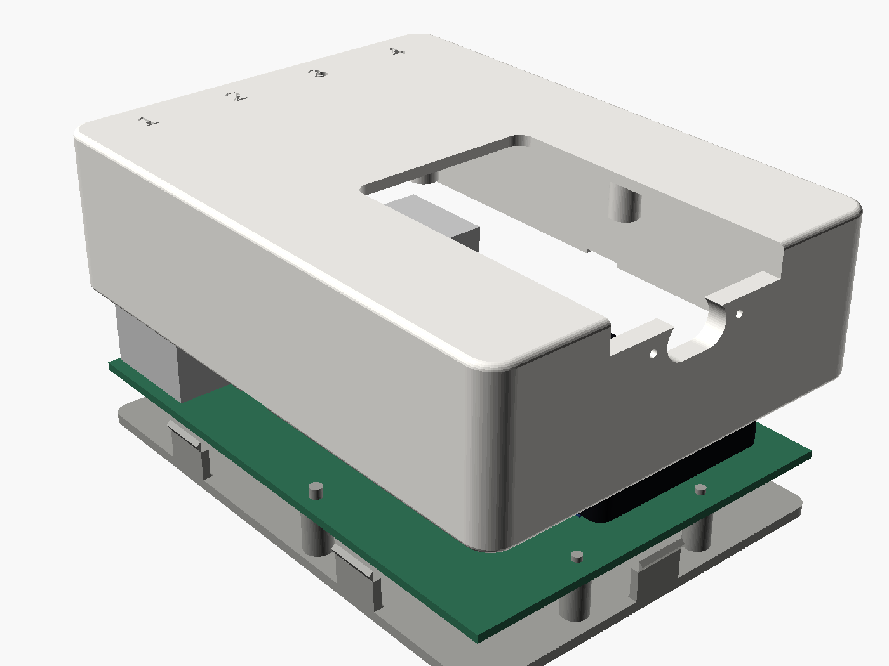

# RS232-WLAN-Konsole

Mobiler serieller Konsolenserver auf ESP32-Basis: mit dem WLAN-Hotspot des Geräts verbinden, `http://192.168.4.1` öffnen, Terminal auf Switch, Router oder Firewall. Keine App, kein Treiber, kein USB-Seriell-Adapter — und auf Wunsch aus der Ferne über die Leitstelle.

Firmware-Stand: **v1.8.2** · Board: **Waveshare ESP32-S3-Touch-LCD-2** · Oberflächen auf Englisch, Deutsch und Portugiesisch

<p align="center">
  
</p>

## Was es kann

| Wo | Was |
|---|---|
| **Am Gerät** | Touch-Display mit Portstatus, Baudrate, Auto-Baud, BREAK, Terminal und Skripten; Akku mit Ladeanzeige und Sparmodus |
| **Im Browser** | xterm.js-Terminal über den eigenen Hotspot oder das Firmennetz, ohne Installation — am Handy wie am Notebook |
| **Im Netz** | Raw-TCP und Telnet je Port (PuTTY), Bluetooth-LE-Konsole, XMODEM/YMODEM, 802.1X (PEAP, TTLS, EAP-TLS), HTTPS |
| **Auf der SD-Karte** | Mitschnitte je Port, gespeicherte Konfigurationen zum Abspielen, verschlüsselte Sicherung; die Karte lässt sich als USB-Stick verleihen |
| **Aus der Ferne** | Leitstelle mit Geräteübersicht, Fernkonsole Ende-zu-Ende verschlüsselt, Firmware-Updates nur signiert (ML-DSA-65), Images auf die SD-Karte |

<table>
  <tr>
    <td align="center" width="38%"><br><sub>Touch-Display am Gerät</sub></td>
    <td align="center"><br><sub>Weboberfläche des Geräts am Handy</sub></td>
  </tr>
</table>

## Leitstelle

Geräte melden sich ausgehend per HTTPS bei einem Server — kein offener Port am Gerät, kein VPN. Der Kanal darin ist hybrid verschlüsselt (X25519 + ML-KEM-768); angemeldet wird mit einem sechsstelligen Code vom Display. Konten mit Passwort und Authenticator-App, Gruppen mit Rechten, Standorte, eine Bibliothek für Vorlagen, Firmware und Images.

Die **Fernkonsole** braucht einen Tipp am Gerät (oder eine dort gesetzte Frist für unbeaufsichtigten Zugriff), läuft höchstens 60 Minuten und ist Ende-zu-Ende verschlüsselt: Der Server trägt nur Chiffretext, Display und Browser zeigen denselben Code. Skripte lassen sich im Terminal abspielen, Sitzungen in eine Textdatei aufzeichnen.

<p align="center">
  
</p>

## Hardware (Entwurf)

Eine Trägerplatine für das Waveshare-Modul mit **vier galvanisch getrennten RS232-Ports auf RJ45** (Cisco-Belegung; je Port Optokoppler, MAX3232E und eigener isolierter Wandler, aus dem Akku schaltbar) und ein druckbares Gehäuse. Entworfen und per KiCad-DRC geprüft, **noch nicht gebaut** — Quellen, Gerber für PCBWay und STL-Dateien im Zweig [`hardware-carrier`](../../tree/hardware-carrier/hardware).

<table>
  <tr>
    <td align="center"><br><sub>Trägerplatine 78 × 107 mm</sub></td>
    <td align="center"><br><sub>Körper, Platine, Boden</sub></td>
  </tr>
</table>

Heute läuft das Gerät mit einem MAX3232-Modul an einem Port, geprüft an Cisco C3750-X und C2960CX.

## Aufbau

- [`HANDOVER.md`](HANDOVER.md) — Projektstand, Erfahrungswissen, offene Punkte
- [`firmware/`](firmware/) — PlatformIO-Projekt für das Waveshare ESP32-S3-Touch-LCD-2 ([Weboberfläche und Netz](firmware/README.md), [Board](firmware/WAVESHARE.md))
- [`server/`](server/) — Leitstelle (Command-and-Control-Server) in Go: [Konzept](server/KONZEPT.md), [Betrieb und Admin-API](server/README.md)
- [`tests/`](tests/) — Host-Unittests der Firmware und Protokolltests gegen den Server

```bash
cd firmware
pio run -t upload                          # Englisch
pio run -e waveshare-s3-lcd2-de -t upload  # Deutsch (-pt: Portugiesisch)

cd server
docker compose up -d --build               # Leitstelle lokal, siehe server/README.md
```
