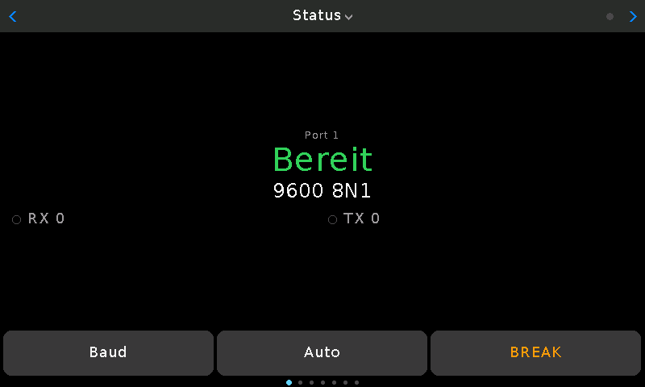

# VIEWE UEDX80480050E-WB-A (5″, 800×480)

Zweites Board neben dem Waveshare ESP32-S3-Touch-LCD-2, um dieselbe Firmware an einer anderen Art von Panel zu erproben: paralleles RGB mit Bildspeicher im PSRAM statt SPI. Hersteller-Unterlagen: <https://github.com/VIEWESMART/UEDX80480050ESP32-5inch-Touch-Display>.

ESP32-S3 (N16R8: 16 MB Flash, 8 MB Octal-PSRAM), ST7262-Panel an 16 RGB-Leitungen, GT911-Touch, SD-Slot an eigenen SPI-Leitungen, USB-C über einen CH340 an UART0. Kein Akkuanschluss, kein Lagesensor.

```bash
pio run -e viewe-s3-5inch -t upload --upload-port /dev/serial/by-id/usb-1a86_USB_Serial-if00-port0      # Englisch
pio run -e viewe-s3-5inch-de -t upload --upload-port ...                                                  # Deutsch
pio run -e viewe-s3-5inch-pt -t upload --upload-port ...                                                  # Portugiesisch
LCD_PORT=/dev/serial/by-id/usb-1a86_USB_Serial-if00-port0 tools/lcd_debug.py status shot bild.png
```

Der Upload-Port muss genannt werden, solange das Waveshare-Board am selben Rechner hängt. `lcd_debug.py` sucht von sich aus nur das Waveshare-Board; fürs VIEWE-Board `LCD_PORT` setzen. Das Öffnen des Ports setzt das Board nicht zurück.



## Was anders ist als am Waveshare-Board

Alles Boardspezifische steht in `src/config.h` unter `BOARD_VIEWE_5INCH`; die Umgebung in `platformio.ini` setzt den Schalter.

| | Waveshare 2″ | VIEWE 5″ |
|---|---|---|
| Panel | ST7789 an SPI, 240×320, 16 Bit | RGB parallel, 800×480, 24 MHz Pixeltakt, 59 Bilder/s, 8 Bit je Pixel (256 Farben); eigener Bus `src/rgb_bounce.*` unter `lgfx::Panel_RGB` |
| Touch | CST816D | GT911 an IO19/IO20 |
| Oberfläche | `lcd_ui.cpp` | dieselbe — die Seiten richten sich nach Breite und Höhe |
| Terminal | 6×8-Schrift, 53 Spalten | 8×16-Schrift, 99 Spalten |
| `Serial` | USB-CDC des Chips | UART0 (IO43/IO44) hinter dem CH340, 115200 Baud |
| Port 1 | RX IO44, TX IO21 | RX IO18, TX IO17 — die einzigen freien Pins |
| SD-Karte | teilt sich SPI mit dem LCD | eigener Bus (IO10–13) |
| USB-Stick-Modus | ja | nein: die USB-Pins des Chips tragen den Touch-Bus |
| Lagesensor, Drehen | QMI8658 | keiner (auch laut Hersteller-Unterlagen nicht); Querformat (`settings.displayFlip` dreht um 180°) |
| Akku | Messung an IO5, Sparmodus | keine Messung, kein Sparmodus |
| Firmware-Kennung (`FW_BOARD_ID`) | `waveshare-s3-lcd2` | `viewe-s3-5inch` |

Pins stammen aus den Beispielen des Herstellers (`examples/esp_idf/lvgl_v9_demo_5inch/common/hw_init/lcd/lcd_init_rgb.c`, gleichlautend in `ESP32_Display_Panel`), die Zeiten aus dem Datenblatt des Panels (`datasheet/UE050WV-RB40-A116_SPEC_V1.0.pdf`, Tabelle „Parallel 24-bit RGB Input Timing“). Anders als die frühere LVGL-Fassung für dieses Board (bis Commit `3bbc16c`) läuft diese auf Arduino-Core 2.0.17 wie das Waveshare-Board.

## Wie das Panel angesteuert wird — und was nicht ging

Ein RGB-Panel hat keinen eigenen Bildspeicher: Der Prozessor muss das ganze Bild ohne Pause immer wieder herausschieben. Was dabei am Board beobachtet wurde, in der Reihenfolge der Versuche:

| Versuch | Bild |
|---|---|
| LovyanGFX `Bus_RGB`, 20 und 14 MHz, `hsync_polarity`/`vsync_polarity` 0 | schnelles Flackern, nicht lesbar |
| dasselbe mit 12 MHz | das Testbild des Panels (Rot, Grün, Blau, Weiß im Wechsel): es erkennt kein Signal mehr |
| Polarität und Taktflanke richtig (siehe unten), 16 bis 25 MHz | Bild da, aber es reißt und springt seitlich |
| eigener Bus mit Bounce-Buffern, 16 Bit, 20 MHz, Kopie durch den Prozessor | gemessen: jedes sechste Bild verliert den Tritt (Kopie 237 µs, Zeit dafür 345 µs) |
| dasselbe, Kopie durch einen zweiten DMA-Kanal | in Ruhe 2-mal in 20 s neu angesetzt, beim Blättern 9-mal in 5 s |
| 8 Bit je Pixel, 20 MHz | 0 Verluste in Ruhe und beim Blättern; vom Besitzer als ruhig bestätigt (46 Bilder/s) |
| 8 Bit, 24 MHz, Zeiten des Datenblatts, drei Buffer | gemessen 0 Verluste, 58,5 Bilder/s — **der jetzige Stand** |

Daraus:

- **Polarität in LovyanGFX:** `hsync_polarity`/`vsync_polarity` sind der Ruhepegel der Leitung, und die Taktflanke wählt `pclk_idle_high` (`pclk_active_neg` wertet die Bibliothek nicht aus). Die Angaben des Herstellers — Sync-Impulse nach unten, Daten gültig auf der fallenden Flanke — heißen dort 1 / 1 / 1.
- **Takt:** Das Datenblatt verlangt 23–27 MHz. Die 12–16 MHz, mit denen andere 800×480-Boards an LovyanGFX laufen, sind hier zu wenig.
- **Warum es riss:** `Bus_RGB` lässt die DMA-Einheit den Bildspeicher direkt aus dem PSRAM lesen. Flash und PSRAM teilen sich einen Bus, und vor der LCD-Einheit liegen nur rund 40 Pixel Vorrat: Ist der Bus einen Augenblick belegt, kommt der Rest der Zeile zu spät. Der Hersteller (ESP-IDF 5) umgeht das mit Bounce-Buffern; ESP-IDF 4.4 im Arduino-Core 2 kennt sie nicht.
- **`src/rgb_bounce.h/.cpp`:** Die DMA-Einheit liest reihum drei Buffer im internen RAM (je 12 Zeilen, 9,6 kB). Ist einer gesendet, kopiert ein zweiter DMA-Kanal (`esp_async_memcpy`) das nächste Stück des Bildspeichers hinein — nicht der Prozessor, der dafür zwei Drittel eines Kerns bräuchte. Dieser Kanal liest am Cache des Prozessors vorbei, deshalb meldet `flush()` jede gezeichnete Zeile mit `written()`. Kommt ein Interrupt zu spät, wird das verpasste Stück übersprungen (ein Streifen alter Zeilen für ein Bild); stimmt die Zahl der Stücke am Bildende nicht, wird neu angesetzt.
- **8 Bit je Pixel:** Der PSRAM liefert rund 50 MB/s; ein 16-Bit-Bild bei 20 MHz braucht davon dauernd 40. Mit RGB332 ist es die Hälfte. Die 16 Leitungen des Panels bekommen die Bits wiederholt; `lcd_ui.cpp` nimmt dafür Farben, die es in RGB332 gibt (kein neutrales Grau — die Flächen gehen ins Bläuliche). Zurück auf 16 Bit: `LCD_RGB_BITS` in `config.h`.

### Zeichnen

Auch das Zeichnen läuft über den einen PSRAM-Bus, auf dem der Bildstrom lebt. Gemessen mit `lcd_debug.py bench 100` (so viele Bilder der gerade offenen Seite hintereinander):

| Stand | Bilder/s (Status / Terminal / Info / Setup) |
|---|---|
| Zeichenpuffer, Streifen vergleichen, geänderte kopieren (wie am SPI-Panel) | rund 20, Zeichnen bis 57 ms |
| zwei Bildspeicher, Wechsel zwischen zwei Bildern, Warten auf den Wechsel | 19,6 / 22,3 / 19,5 / 19,4 |
| drei Bildspeicher, kein Warten | 28,7 / 31,7 / 25,2 / 24,0 |
| dazu Löschen per DMA statt `fillScreen()` (11,6 statt 20 ms) | 39,1 / 44,4 / 33,1 / 31,3 — **der jetzige Stand** |

Das gilt für die aufrechte Lage (Drehung 0). Um 180° gedreht (`displayFlip`) läuft der alte Weg mit Vergleichen und Kopieren. Die Obergrenze von 25 Bildern je Sekunde (`DRAW_MIN_MS`) ist an diesem Board auf 16 ms gesenkt.

Nebenwirkung des Löschens per DMA: Im Dauerlauf des Messprogramms brauchte das Nachfüllen eines Bounce-Buffers einmal 1,3 ms statt der üblichen 0,3 (Zeit dafür: 0,8 ms). Das zeigt für ein Bild einen Streifen von zwölf alten Zeilen; den Tritt verliert der Bildstrom dabei nicht (0 Neuansätze in 1200 Bildern).

Fallen beim Bauen: `LGFX_Sprite::setBuffer(..., bpp)` stellt die Pixelgröße des Sprites nicht um — ohne `setColorDepth()` davor schreibt er mit 16 Bit über den Buffer hinaus (Heap zerstört, Absturz im WLAN-Task). `esp_async_memcpy` meldet Fehler mit `ESP_LOGE`; im Interrupt endet das in `abort()`, deshalb ist sein Log-Tag stummgeschaltet.

Zum Nachmessen ohne Hinsehen zeigt `lcd_debug.py status` die Zeile `RGB:` — Bilder, Neuansätze, Kopierzeit, übersprungene Stücke seit der letzten Abfrage. `lcd_debug.py pclk N` startet mit einem anderen Pixeltakt neu (bis zum Ausschalten), `bl 1` schaltet das Licht ohne PWM fest an, `radio 0` den Funk bis zum Neustart aus.

## Stand (13. Oktober 2026)

**Stand der übrigen Firmware:** Commit `61fcd60` (dazu seit `06ade07`: TLS-Speicher aus dem PSRAM für alle Boards, Netzsuche trotz laufender Anmeldung, Debug-Befehl `eap`). Der Zweig `viewe-5inch` sitzt auf diesem Commit; die Änderungen fürs VIEWE-Board sind nicht committet. Das Board meldet sich mit dem Hardware-Typ `viewe-s3-5inch`.

**Zweites Gerät an der Leitstelle (13. Oktober 2026):** DNS-Server `192.168.10.123` und Serveradresse `https://control.niko.de` übers Netz gesetzt (`POST /api/settings`, `POST /api/c2/server`), wie am Waveshare-Board. Das Gerät hat sich angemeldet und wartet auf die Bestätigung des Codes vom Display (Handshake 3,9 s, davon Rechnen 1,7 s). Dafür waren zwei Dinge nötig, siehe „Internes RAM“ unten.

Am Board geprüft, über die Debug-Konsole am USB-Kabel:

- Start ohne Absturz; Panel 800×480, Zeichenpuffer 8 Bit im PSRAM; 31 kB RAM frei nach dem Start, im Betrieb 54 kB, kleinster Stand während der Anmeldung 29 kB.
- Bildstrom: 1178 Bilder in 20 s in Ruhe und 318 in 5 s beim Blättern durch die Seiten, kein Verlust; Kopie 217 µs im Mittel, längste 565 µs; Last der Kerne 9 % / 5 %.
- Alle Seiten per Screenshot angesehen (Status, Netz, Terminal, Info, Setup, WLAN-Liste) — sie füllen die 800×480 Pixel, nichts ist abgeschnitten.
- Simulierte Taps kommen an (Seite Setup → „Netz waehlen“ → „Neu suchen“).
- Funk: Hotspot `RS232-7D94` vom Laptop gesehen (auf Kanal 1 mit −34 dBm bei 19,5 dBm Sendeleistung), Bluetooth-Name ebenso; die WLAN-Suche am Board findet die Netze der Umgebung. Auf Kanal 6 sah der Laptop den Hotspot bei keinem Versuch — vermutlich seine Suche, nicht das Board; mit einem Handy nachprüfen.
- Das Waveshare-Board baut unverändert (`pio run -e waveshare-s3-lcd2`).

Vom Besitzer am Panel gesehen: mit 8 Bit und 20 MHz steht das Bild ruhig. Die 24 MHz und das schnellere Zeichnen danach sind bisher nur gemessen. Der Touch wird benutzt: Das Board wurde am Display ins WLAN `home` gebracht und die Helligkeit verstellt (in den Screenshots zu sehen).

**Nicht geprüft:**

- Das Bild unter Last: Leitstelle (TLS), Firmware-Update, Dateiübertragung, viele Browser.
- Serieller Port an IO17/IO18, SD-Karte (keine eingelegt), Weboberfläche im Browser, Leitstelle, Firmware-Update mit der neuen Kennung.

**Nachtrag 13. Oktober 2026, abends:** Das Board hängt mit EAP-TLS am Testnetz `rs232-dot1x` (Zertifikat `rs232-viewe`). Über die Leitstelle im Internet geprüft: Firmware-Update (95 s, Paket `viewe-s3-5inch`; ein Waveshare-Paket lehnt der Server ab) und Fernkonsole (angefragt, am Display erlaubt, Zeichen bis zum Port, am Display beendet). Internes RAM in diesem Netz: 33–38 kB frei, größter Block 22–27 kB, Tiefststand 7 kB — der Schlüsseltausch kommt deshalb mit einem kleineren Stack aus (`big()` in `c2.cpp`).

## Offen

- Beim Dialog der Fernkonsole bleibt die Statusseite dahinter leer (kein „Bereit“/„In Benutzung“ über dem Dialog) — am 2″-Panel steht der Text dort.


- Schrift und Tasten haben dieselbe Größe in Pixeln wie am 2″-Panel; die Pixeldichte ist fast gleich (7,4 statt 7,8 Pixel je Millimeter), die Seiten wirken auf 5″ deshalb leer. Eine eigene Aufteilung für das große Panel (zwei Spalten, größere Schrift) steht aus.
- „Ausschalten“ im Setup führt in den Tiefschlaf; geweckt wird mit der BOOT-Taste (IO0) — am Board nicht ausprobiert.
- Die Anzeige geht wie am Waveshare-Board nach 60 s aus und wacht nur durch eine Berührung auf (kein Lagesensor).

## Internes RAM

Der eigene Bus kostet internes RAM (drei Bounce-Buffer zu 9,6 kB), und davon lebt auch TLS: Der Arduino-Core ist mit `CONFIG_MBEDTLS_INTERNAL_MEM_ALLOC` gebaut. Der erste Versuch, das Board bei der Leitstelle anzumelden, endete mit „SSL - Memory allocation failed“, der zweite mit „Handshake nicht begonnen“ (kein Block von 24 kB für den Stack des Schlüsseltauschs). Was geholfen hat:

- **TLS-Speicher aus dem PSRAM:** zuerst mit einer eigenen Umleitung nur für dieses Board (`src/tls_mem.cpp`, Blöcke ab 1 kB), seit dem Zusammenführen mit `main` am 13. Oktober 2026 für alle Boards gleich in `main.cpp` (`tlsCalloc`, `mbedtls_platform_set_calloc_free`): **alles** aus dem PSRAM. Die Grenze bei 1 kB ließ dem Waveshare-Board bei EAP-TLS nur 1 kB internes RAM übrig.
- **Bounce-Buffer und Nullen statisch** (`.bss`) statt vom Heap: Nach dem Start des Funks angelegt, lagen sie mitten im Heap und zerteilten ihn.
- Kleiner gemacht: Terminal-Raster 24 statt 48 Zeilen, Zeilenpuffer des Screenshots aus dem PSRAM, Null-Block fürs Löschen 2 statt 4 kB.

Während des TLS-Handshakes wurden zwei Bounce-Buffer übersprungen (zwei Streifen alter Zeilen für je ein Bild).

## Seriellen Port zum Testen anschließen

Port 1 liegt an **IO17 (TX, sendet)** und **IO18 (RX, empfängt)**, an der Stiftleiste mit `17` und `18` beschriftet. Die Pins führen **3,3-V-Logikpegel** — eine echte RS232-Schnittstelle (±12 V) nie direkt anschließen.

```
A  Schleife (ohne Teile): was gesendet wird, kommt zurück

   VIEWE   IO17 (TX) ──┐
                       │  eine Drahtbrücke
           IO18 (RX) ──┘

B  USB-Seriell-Adapter mit 3,3-V-Pegel am Rechner (oder ein zweites Board, gekreuzt)

   VIEWE   IO17 (TX) ──────────► RXD   Adapter
           IO18 (RX) ◄────────── TXD   (Jumper auf 3,3 V)
           GND ───────────────── GND
                                 VCC bleibt frei

C  echtes Gerät (Switch, Router): MAX3232-Modul dazwischen

   VIEWE   3.3V ───────► VCC          MAX3232          DB9-Stecker
           GND ────────► GND ─────────────────────────► Pin 5 (GND)
           IO17 (TX) ──► T1IN      T1OUT ─────────────► Pin 3 (TXD)
           IO18 (RX) ◄── R1OUT     R1IN  ◄───────────── Pin 2 (RXD)
```

Zu C: So belegt verhält sich der DB9-Stecker wie die Schnittstelle eines PCs (DTE); ein Cisco-Konsolenkabel (RJ45 auf DB9) passt direkt. Zwischen zwei Rechnern braucht es ein Nullmodemkabel — das Häkchen „RX/TX tauschen“ ersetzt es nicht. IO18 ist ab Werk ein freier Pin (Touch-Interrupt erst nach Umlöten von R28 auf R33).
